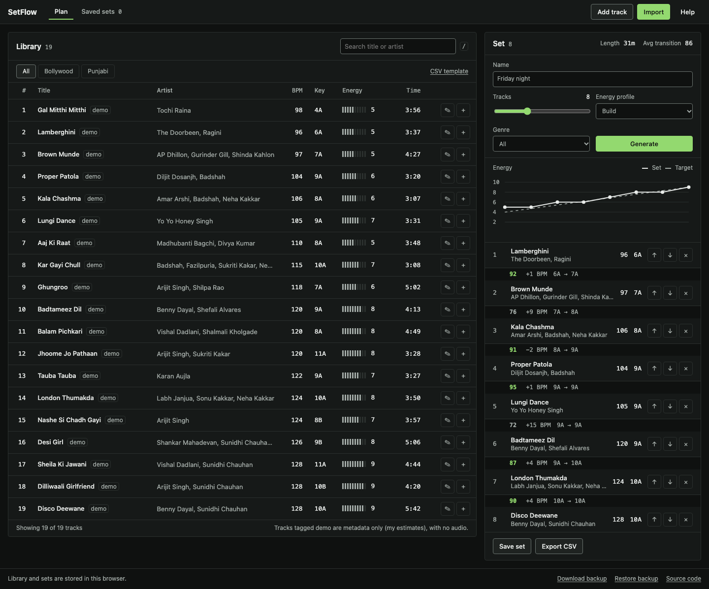

# SetFlow

I DJ Bollywood sets, and planning the order of tracks by hand meant juggling tempo, key, and energy across dozens of songs. SetFlow is a browser app I built to do that: import local audio, a CSV, or my Rekordbox library, generate an energy-aware sequence, inspect each transition, and save or export the set.

**Live demo: https://gosainansh8.github.io/setflow/** (runs entirely in your browser; nothing is uploaded)



## How to use it

1. Fill your library with the demo tracks, local audio, a CSV, or a Rekordbox XML export.
2. Check the estimated BPM, Camelot key, and energy, and fix anything wrong. Keys the analyzer is unsure about are marked in amber with a ?.
3. Pick an energy profile: Build rises steadily, Rise & release peaks mid-set, and Steady holds one level.
4. Generate a set, which orders up to 20 tracks and scores every transition.
5. Reorder by dragging or with the keyboard, then save the set or export the play order as CSV.

## Run locally

Requires Python 3 for a local server and Node.js 18+ for tests. There are no npm dependencies or build steps.

```bash
python3 -m http.server 8000 --directory dist
# Open http://localhost:8000
node --test tests/*.test.mjs
```

Serve over localhost or HTTPS for browser audio features. Opening index.html directly as a file won't work, since ES modules require a server.

## Features

- Track library and set builder side by side, with search, sorting, and genre filters built from the library
- In-browser audio decoding, with signal processing in a Web Worker
- Estimated BPM (with half-time and double-time correction), Camelot key with a confidence score, and energy, plus a waveform preview with seeking
- Imported audio kept in IndexedDB so it still plays after a reload, with a one-click way to delete it
- CSV import with quoted fields and validation; keys can be Camelot (8A) or musical (Am)
- Rekordbox XML import for title, artist, genre, BPM, key, and duration, skipping unanalyzed tracks with a report
- Beam-search set planner with three energy profiles and a score on every transition
- Drag-and-drop and keyboard reordering, with focus kept on the moved track
- Saved sets, CSV export in play order, and JSON backup and restore
- A benchmark script that measures BPM and key accuracy against tracks I label by hand

## Design decisions

**Beam search for ordering.** Finding the best order of n tracks is a traveling-salesman-style problem: there are n! orderings, so 20 tracks is about 2.4 quintillion. A greedy pick of the best next track is fast but paints itself into corners, like spending all the compatible keys early. Beam search keeps the 36 best partial sets at each position and extends all of them, so it can recover from a locally good but globally bad choice. It runs in milliseconds for 100 candidates and gives up only the guarantee of the true optimum, which doesn't matter when the scores are heuristics anyway.

**A Web Worker for analysis.** Autocorrelation over 90 seconds of audio and 300 FFTs take a second or two. On the main thread that would freeze the page, including the import progress message. The worker gets the samples as a transferable buffer (moved, not copied), does all the math, and posts back a small result. The same file runs unchanged in Node for the tests and the benchmark, since it only touches `self.onmessage` and `self.postMessage`.

**No backend.** DJs have big local libraries and don't want to upload them. Everything runs in the browser: the Web Audio API decodes, the worker analyzes, localStorage keeps metadata, and IndexedDB keeps audio. That makes hosting free (GitHub Pages), keeps the app working offline once loaded, and means there's no account, server, or data to secure. The cost is that data lives in one browser, which the backup and restore buttons cover.

**UI choices.** DJ software is dense and numeric, and it's used in dark rooms, so I built it that way:

- The main screen is the tool itself: a library table next to the set builder, with no landing-page hero.
- Dark theme, with every text color checked against WCAG AA. Muted text is 6.8:1 at its lowest, and control borders are at least 3:1.
- System fonts only: a sans for text, and a tabular monospace for BPM, key, energy, and time so the digits line up in columns. Nothing loads from a font CDN.
- One accent color, used only for meaning: good transitions, the primary action, and keyboard focus. Rough transitions are amber.
- One spacing scale (4px steps) and one type scale defined as CSS variables, with no gradients, animations, or decorative cards.
- Plain labels instead of slogans, and hover and focus states that change the surface and border so it's clear what will happen.

## Architecture

- `dist/app.mjs`: UI events and local application state
- `dist/core.mjs`: pure, tested functions for scoring, planning, CSV, key notation, and Rekordbox XML
- `dist/analyzer.js`: signal processing in a Web Worker
- `dist/audio-store.mjs`: IndexedDB storage for imported audio files
- `dist/index.html`, `dist/style.css`: responsive UI with no framework or image assets
- `scripts/benchmark.mjs`: accuracy measurement against hand-labeled tracks

## Sequencing algorithm

For adjacent tracks a and b:

- Tempo: max(0, 1 - |a.bpm - b.bpm| / 24)
- Harmonic fit: same Camelot key 1.0; relative major/minor 0.9; adjacent wheel number, same mode 0.85; two steps 0.5; otherwise 0.15
- Energy: max(0, 1 - |a.energy - b.energy| / 6)
- Transition score: round(100 * (0.4 * tempo + 0.4 * harmonic + 0.2 * energy))

The planner extends each partial sequence with every unused track and keeps the best 36 at each position (beam width 36). Each step weighs 62% transition score and 38% fit to the chosen energy profile. The candidate pool is capped at 100 tracks and sets at 20. In the set builder, scores of 80 and up are highlighted and scores under 65 are amber.

Energy profiles: Build rises from 4 to 9, Rise & release follows 5 + 4 sin(pi * p), and Steady targets 7.

## Audio analysis

1. Decode the file with the Web Audio API.
2. Downmix up to 90 seconds to mono at 11,025 Hz.
3. Build an onset envelope from rises in RMS loudness over 11.6 ms frames, lightly smoothed.
4. Score every tempo from 60 to 180 BPM by how well the envelope lines up with itself 1 to 4 beats later, and take the best.
5. Correct octave errors: a beat at B BPM also lines up at B/2, so the raw best is often half time. If doubling the tempo keeps at least half of the one-beat score, the faster tempo wins. A genuinely slow beat can't pass that test, because nothing happens halfway between its hits.
6. Compute Hann-windowed FFTs, pool magnitudes into 12 pitch classes (chroma), and correlate against the 24 major and minor key profiles. The best match is the key, and its correlation is the key confidence. Below 0.7 the key is flagged. On synthetic signals, clear chords scored 0.80 to 0.98, a lone note 0.68, and noise about 0.33.
7. Estimate energy from loudness and tempo.

This is a lightweight baseline, not commercial-grade analysis, so I check results by ear or import metadata from Rekordbox. Clips under three seconds and silence are rejected; files are limited to 100 MB.

## Import formats

CSV:

```csv
title,artist,bpm,key,energy,duration,genre
My Track,Artist,124,8A,7,240,House
```

Duration in seconds; BPM 40 to 240; keys 1A to 12B or musical (Am, F#m, Db); energy 1 to 10; up to 1,000 rows per file. A bad row rejects the file with its row number.

Rekordbox: in Rekordbox, choose File, then Export Collection in xml format, and import the .xml file. SetFlow reads the tracks in the collection (not the playlist references) and maps Name, Artist, Genre, AverageBpm, Tonality, and TotalTime. Tracks Rekordbox hasn't analyzed, invalid tracks, and tracks already in the library are skipped and listed in the import report. Rekordbox doesn't export energy, so imported tracks start at 5.

## Measuring accuracy

The unit tests use synthetic signals, so they don't tell me how the analyzer does on real music. For that I label tracks by hand and run the benchmark:

```bash
node scripts/benchmark.mjs labels.csv --out results.csv
```

`labels.csv` has a `path,bpm,key` header; paths are relative to the CSV, and keys can be Camelot or musical. WAV files are decoded by the script; other formats need ffmpeg. It prints BPM accuracy within 2 BPM (with and without allowing octave errors), exact and compatible key accuracy, and key accuracy above and below the 0.7 confidence flag. I haven't published numbers yet; they'll go here once I've labeled a real crate.

## Testing

`node --test tests/*.test.mjs` runs 23 tests covering Camelot wraparound, score bounds, beam-search uniqueness and energy shaping, CSV round-trips, invalid metadata, musical-to-Camelot key conversion, Rekordbox XML parsing and validation, synthetic tempo detection at 64 to 174 BPM including 70 and 140 octave cases, key detection and confidence on synthetic chords, silent and short input, and the benchmark's scoring, WAV decoding, and command line.

## Demo content

The demo library is a Bollywood and Punjabi set I'd actually play, ordered roughly from warm-up to peak. The titles and artists are real; the BPM, key, and energy values are my estimates for planning, and no audio is included. Demo tracks are tagged in the library.

## Next steps

- Label a few hundred tracks from my own crate, run the benchmark, and tune the octave and key-confidence thresholds
- Estimate energy from audio features beyond loudness and tempo
- Export a set back to Rekordbox as a playlist
- Detect cue points and phrases
